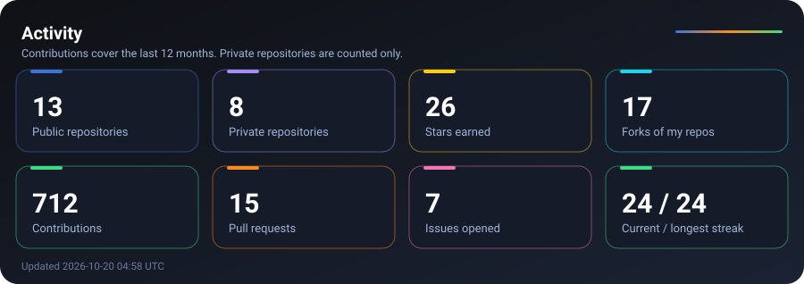
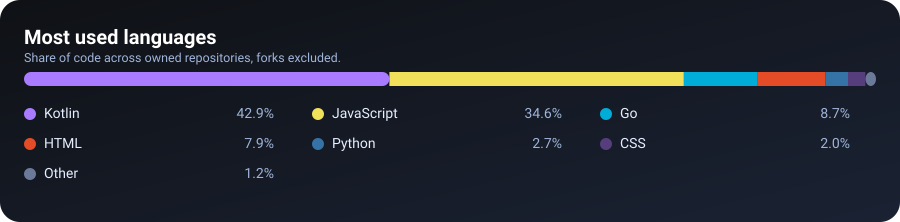

  

  <picture>
    <source media="(prefers-color-scheme: dark)" srcset="https://raw.githubusercontent.com/bhawan-kavinda/bhawan-kavinda/output/github-snake-dark.svg">
    <source media="(prefers-color-scheme: light)" srcset="https://raw.githubusercontent.com/bhawan-kavinda/bhawan-kavinda/output/github-snake.svg">
    
  </picture>

---

### Overview

Solo developer from Sri Lanka building web and mobile products.

- Exploring new technologies and building cool software.
- Focused on scalable web apps, clean code, and modern design.
- Goal: continuous learning and contributing to open source.

**25** repositories (**12** public, **13** private). Most used: Kotlin, JavaScript, Go.

---

### Activity

  

---

### Languages and topics

  

`android` `apk` `github-actions` `apk-build` `automation` `backup` `battery` `battery-monitor` `capacitor` `ci-cd` `cloudflare-workers` `cpu-monitoring`

---

### Tech stack and tools

<b>Languages</b>

  

<b>Frameworks and Platforms</b>

  

  

<b>DevOps</b>

  

<b>Tools</b>

  

---

### Featured projects

<table>
<tr>
  <td width="50%" valign="top">
    <a href="https://github.com/bhawan-kavinda/Web2APK"><b>Web2APK</b></a> 
    Turn any website or web project into an Android APK using GitHub Actions. No Android Studio, no local setup. Copy one folder and push. 
    JavaScript &middot; 5 stars
  </td>
  <td width="50%" valign="top">
    <a href="https://github.com/bhawan-kavinda/SysStatus"><b>SysStatus</b></a> 
    Live battery, RAM and CPU stats for Android with a floating window. No root, no internet permission, no ads, no trackers. Open source, built with Kotlin and Jetpack Compose. 
    Kotlin &middot; 2 stars
  </td>
</tr>
<tr>
  <td width="50%" valign="top">
    <a href="https://github.com/bhawan-kavinda/Mirror-Repo"><b>Mirror-Repo</b></a> 
    Automatic GitHub → GitLab mirroring. Push to GitHub, and the same commits, branches and tags land on GitLab seconds later. Zero servers, Python stdlib only. 
    Python &middot; 2 stars
  </td>
  <td width="50%" valign="top">
    <a href="https://github.com/bhawan-kavinda/portfolio"><b>portfolio</b></a> 
    A tiny 16-bit village walk game built with HTML, CSS and JavaScript, shown as a portfolio piece. 
    HTML &middot; 2 stars
  </td>
</tr>
</table>

---

### Connect with me

  
  &nbsp;&nbsp;
  
  &nbsp;&nbsp;
  
  &nbsp;&nbsp;
  
  &nbsp;&nbsp;
  
  &nbsp;&nbsp;
  

---

Generated from repository data by GitHub Actions. Last updated 2026-10-23 17:14 UTC.

